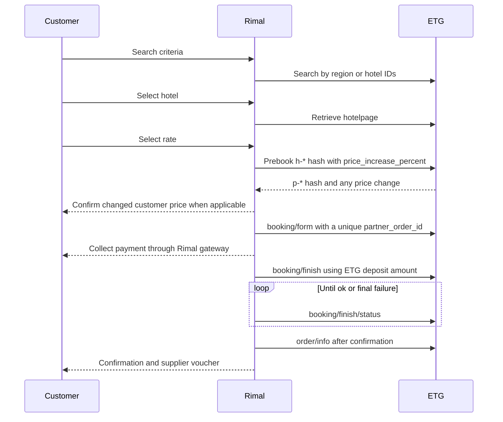

# RateHawk B2B certification readiness

Assessment date: 2026-10-22

This assessment covers the website B2B `deposit` flow and follows the current
ETG Integration Guide, Integration Requirements, and Certification guidance.

## Implemented workflow

The customer charge includes the configured markup. The ETG `deposit` amount
and currency are preserved unchanged for `booking/finish`.

## Required integration coverage

| ETG requirement | Implementation | Evidence |
| --- | --- | --- |
| Offline Content API synchronization | Implemented | Filter values, hotel IDs by filter, content by IDs, incremental synchronization and local search cache tests |
| Search by region or hotel IDs | Implemented | Search routes and RateHawk client coverage |
| Retrieve hotelpage only for a selected hotel | Implemented | Public hotelpage route and live Sandbox verification |
| Hotelpage prebook and `h-*` to `p-*` hash flow | Implemented | Checkout preflight and unit coverage |
| Price-change handling | Implemented | Customer price validation and certification scenario |
| `booking/form` retries with a new ID, maximum 10 | Implemented | Durable booking process and passing retry test |
| One-hour booking-form validity | Implemented | Persisted expiry and finish guard |
| Charge customer between form and finish | Implemented | Ziina intent is created after form and finish runs only after verified payment |
| `booking/finish` is never blindly retried | Implemented | Durable one-shot finish claim and reconciliation |
| Poll `booking/finish/status` through transient outcomes | Implemented | Foreground status checks plus background reconciliation |
| Final error mapping | Implemented | `soldout`, `book_limit`, provider and other documented final errors |
| Retrieve booking after confirmation | Implemented | Delayed post-booking information and voucher flow |
| Cancellation | Implemented behind explicit rollout gates | Durable cancellation, penalty read, and refund reconciliation |

## Sandbox certification run

Render one-off job: `job-dbd57v3l550s73ane860`

Result:

- 6 confirmed scenarios.
- 2 expected failed scenarios.
- 0 pending, paused, or errored scenarios.
- 0 unmet expectations.

The Staging runtime readiness check reported `configurationReady: true`,
Sandbox checkout ready, and no configuration blockers. The deployed frontend
and backend both report revision `aaab257161456d8190817a19fa3ec40c6ffabaa1`.

Covered scenarios:

- standard booking;
- multiroom booking with adults and children;
- child age boundaries;
- Uzbekistan residency;
- prebook price increase;
- `unknown` followed by success;
- `unknown` followed by `soldout`;
- `unknown` followed by `book_limit`.

The full supplier exchange log contains test guest information and must be
transferred to ETG only through an approved secure channel. It must not be
committed to Git.

## Remaining launch actions

These actions require external account configuration or ETG confirmation and
cannot be completed by code alone:

1. Confirm receipt of registration, booking confirmation/voucher, cancellation,
   and refund messages in the approved test mailbox. Staging configuration and
   SMTP authentication are ready, but customer receipt is external evidence.
2. Merge the reviewed certification tooling commit into the maintained Staging
   branch before the next certification rerun.
3. Export the detailed certification exchange log from the controlled test
   environment and provide it securely to ETG if requested.
4. Send ETG the callback URL if the booking-status webhook will be used, and
   confirm the Render outbound IP allowlist with ETG.
5. Request and complete ETG's current Pre-certification Checklist, and provide
   access to the Staging search, booking, and cancellation flow.

Production credentials and real inventory must remain disabled until ETG sends
written certification approval and production access.
